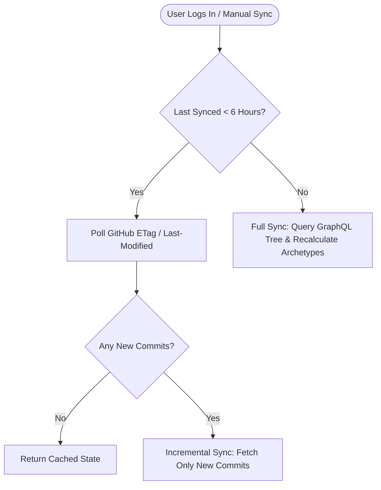

# Repository Synchronization Decision Matrix

## Decision Tree
To balance freshness with GitHub API rate limits, the sync scheduler dynamically decides between an **Incremental Sync** and a **Full Re-index**:

