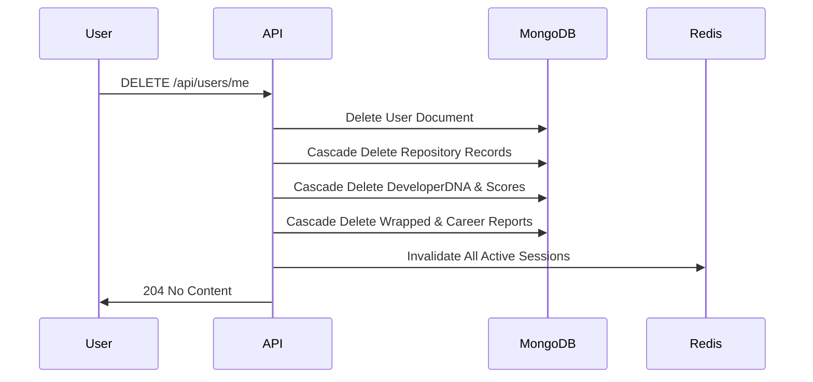

# User Privacy Settings & Data Deletion Cascading Rules

## Privacy Controls
GitInsight AI adheres to GDPR and CCPA principles of data minimization and right-to-erasure.

## Cascading Deletion Workflow
When a user triggers account termination (`DELETE /api/users/me`):

